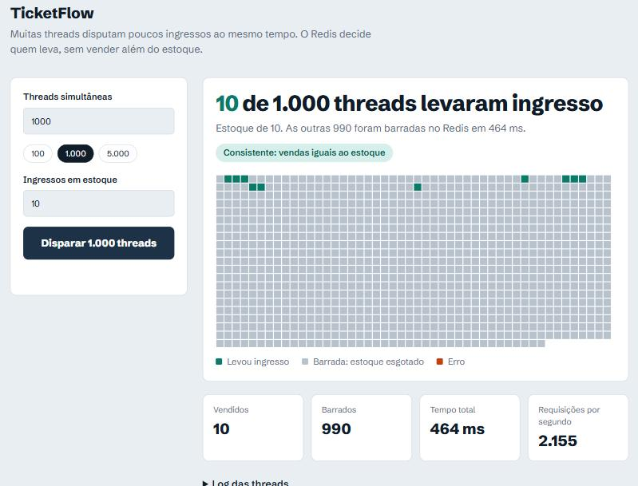
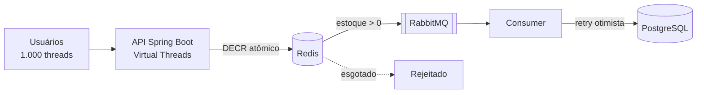
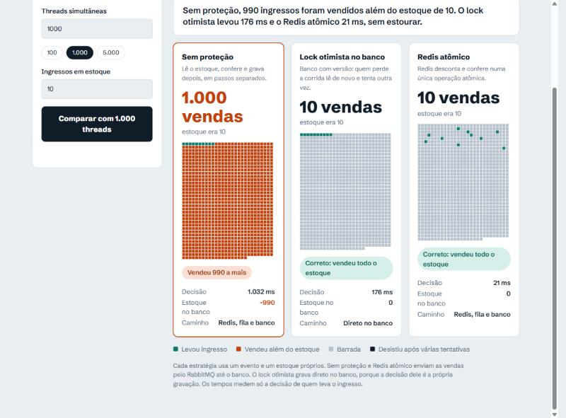

# 🎟️ TicketFlow Simulator


[](https://github.com/Jmello01/ticketflow/actions/workflows/ci.yml)

Um laboratório prático de **Sistemas Distribuídos** e **Engenharia de Performance** criado para resolver um dos problemas mais clássicos da computação: **Race Conditions (Condições de Corrida)** em sistemas de alta concorrência (venda de ingressos).

## O Desafio: O Teste de Estresse (I/O Bound)
Como garantir que 1.000 pessoas tentando comprar 10 ingressos no exato mesmo milissegundo não resultem em "ingressos fantasmas" (vender mais do que o estoque)? Em sistemas mal desenhados, as múltiplas threads leem o banco de dados ao mesmo tempo, burlando a validação de estoque.

Este projeto propõe uma arquitetura blindada que processa 1.000 requisições simultâneas em cerca de meio segundo a 1 segundo, mantendo **100% de consistência** matemática, sem travar o processador.



## Arquitetura e Solução

Para suportar o pico extremo de acessos, a arquitetura foi desenhada em camadas:

1. **Virtual Threads (Java 21):** Substituem as pesadas *Platform Threads*. Permitem que a aplicação inicie milhares de conexões simultâneas (I/O) sem esgotar a memória ou a CPU do servidor.
2. **Redis (O "Escudo Atômico"):** Atua como o validador principal de estoque. Usando operações atômicas (`decrement`), ele atende as threads na memória RAM com consistência absoluta. Se o estoque é 10, o 11º usuário é sumariamente barrado em milissegundos.
3. **RabbitMQ (Mensageria):** As requisições aprovadas pelo Redis não vão direto para o Banco de Dados (que é lento). Elas são enviadas para uma fila assíncrona, amortecendo o impacto (*Load Leveling*).
4. **Consumer & Database:** Um worker consome a fila do RabbitMQ de forma cadenciada e salva no banco de dados com segurança.

### Fluxo da Informação


##  Como Executar o Laboratório

A infraestrutura foi totalmente orquestrada para subir com um único comando, eliminando o problema de "na minha máquina funciona".

### Pré-requisitos
* Docker e Docker Compose instalados.

### Passos
1. Clone o repositório:
   ```bash
   git clone https://github.com/Jmello01/ticketflow.git
   cd ticketflow
   ```

2. Suba a infraestrutura completa (App, Redis, RabbitMQ):
   ```bash
   docker-compose up --build -d
   ```

3. Acesse o Dashboard de Observabilidade no seu navegador: http://localhost:8080

## Modo Comparar: o que acontece sem as ferramentas certas
No dashboard, o modo **Comparar estratégias** roda a mesma disputa (1.000 threads, 10 ingressos) em três abordagens, cada uma com seu próprio evento e estoque:



| Estratégia | Como decide | Resultado medido (1.000 threads, 10 ingressos) |
|---|---|---|
| Sem proteção | Lê o estoque no Redis, confere e grava depois (`GET` + `SET`) | 1.000 vendas, estoque no banco em -990 |
| Lock otimista | Banco com `@Version`, relendo em caso de conflito | 10 vendas, 176 a 560 ms |
| Redis atômico | `DECR` em uma operação só | 10 vendas, 21 a 51 ms |

Medido em PostgreSQL 16 (Docker), em quatro rodadas seguidas. A primeira rodada do lock otimista é a mais lenta, por causa do aquecimento da aplicação.

Sem proteção e Redis atômico enviam as vendas pelo RabbitMQ até o banco. O lock otimista grava direto no banco, porque a decisão dele é a própria gravação.

Como ler esses números: todas as threads são liberadas ao mesmo tempo por uma barreira (`CountDownLatch`), o que amplifica a janela entre a leitura e a escrita. É um cenário de pior caso, escolhido de propósito, e os tempos variam entre execuções e máquinas. A comparação cobre só a etapa de decidir quem leva o ingresso.

A API também está disponível diretamente: `POST /api/simulation/compare?threads=1000&tickets=10`.

## Executando os Testes Automatizados
O `TicketConcurrencyTest` usa o Redis real, então suba a infraestrutura antes:

```bash
docker-compose up -d ticket-redis ticket-rabbitmq
./mvnw test
```

Se o container `ticket-app` estiver rodando, pare-o antes (`docker-compose stop ticket-app`). Ele consome da mesma fila `tickets.queue` com um banco próprio, e os testes que esperam a fila esvaziar falham.

Por padrão os testes usam um H2 em memória. Para rodá-los contra o PostgreSQL do compose (publicado na porta **5433**, para não colidir com um Postgres local na 5432):

```bash
docker-compose up -d ticket-postgres ticket-redis ticket-rabbitmq
SPRING_DATASOURCE_URL=jdbc:postgresql://localhost:5433/ticketdb \
SPRING_DATASOURCE_USERNAME=ticketflow SPRING_DATASOURCE_PASSWORD=ticketflow \
./mvnw test
```

O CI do GitHub roda a suíte contra PostgreSQL.

## Realizando o Teste de Estresse
O sistema possui endpoints específicos para controle de estado e simulação.

1. Limpe a Bancada (Obrigatório antes de cada teste):
Acesse a URL para resetar o Redis e a memória interna (evitando estado acumulado/lixo de memória):
http://localhost:8080/api/simulation/reset?eventId=1

2. Dispare a Carga:
Vá no Dashboard (localhost:8080), defina 1000 threads e 10 ingressos, e clique em disparar.

3. Resultado Esperado: O sistema cravará exatamente 10 sucessos e barrará 990 tentativas, provando a eficácia da proteção atômica e o isolamento contra Race Conditions.